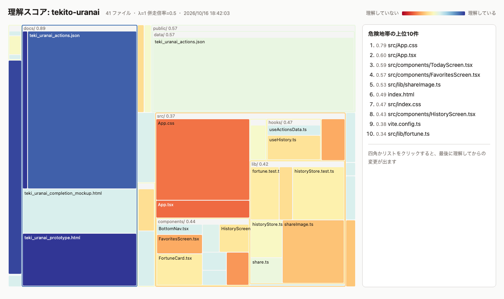

# comprehension-debt

AI がコードを書くほど、人間が「把握しているつもり」の範囲と実際のコードの間にズレがたまっていく。
このズレ（理解負債）を、git の履歴からファイル単位の **理解スコア** として測る CLI。

長期的には、事業・組織・システムの形が揃っているかを見るヘルスチェックを目指している（[docs/vision.md](docs/vision.md)）。
今はその入口として、自分のリポジトリを対象にした段階1を作っている。

<picture>
  <source media="(prefers-color-scheme: dark)" srcset="docs/images/report-dark.png">
  
</picture>

四角の面積がファイルの行数、色が理解スコア（赤：理解していない 〜 青：理解している）。右は危険地帯の上位10件。

## 使う流れ

Node.js 20 以上が必要。分析したいリポジトリを手元に clone しておく。

```bash
npm install
```

### 1. どこを理解していないかを見つける

```bash
# 危険地帯（重要 × 理解していない × よく変わる）の上位10件
npm run cli -- danger ../my-repo
```

```
危険度  score  core  90日  path
  0.79   0.21     -    10  src/App.css
  0.60   0.19     -     5  src/App.tsx
  0.60   0.27     -     6  src/components/TodayScreen.tsx
  0.57   0.30     -     6  src/components/FavoritesScreen.tsx
  ...
```

全体を見たいときは、上の画像のレポートを書き出す。

```bash
npm run cli -- report ../my-repo   # out/index.html をブラウザで開く
```

レポートでファイルをクリックすると、最後に理解してから入った変更の一覧と、その差分を取り出す `git show` のコマンドが出る。

### 2. 理解する

読む、説明を書いてもらう、人に聞く、自分で書き直す。方法は自由（[ADR 0013](docs/adr/0013-leave-understanding-method-to-user.md)）。

### 3. 理解したら記録する

```bash
npm run cli -- ack ../my-repo src/App.tsx src/components/
```

対象リポジトリの `.understanding/acks.jsonl` に記録され、スコアが満点に戻る。この記録は対象リポジトリでコミットしておく。
その後に AI がファイルを変更すると、スコアはまた下がっていく。

### ほかのコマンド

```bash
# 理解スコアの低い順に全ファイル
npm run cli -- score ../my-repo

# ファイルごとに、誰が何行変更したか（自律／併走／人間）
npm run cli -- lines ../my-repo
```

`score`・`danger`・`report` は `--lambda <n>`（AI の変更が理解を下げる強さ、既定 1）と `--pair <n>`（併走の効き方、既定 0.5）で調整できる。

## 仕組み

### コミットの由来を3つに分ける（[ADR 0006](docs/adr/0006-ai-commit-detection-and-line-counting.md)）

| 由来 | 判定 | 意味 |
|---|---|---|
| 自律 | 作者が AI（`Claude`、`[bot]` など） | AI が人間の手元を離れて書いた |
| 併走 | 作者は人間で、`Co-authored-by` に AI | 人間が AI と一緒に作業した |
| 人間 | どちらでもない | 人間だけで書いた |

### 履歴を再生してスコアを上げ下げする（[ADR 0007](docs/adr/0007-understanding-score-model.md)）

ファイルの変更履歴を古い順に再生し、理解度（0〜1）を更新していく。

- **人間の変更**: 変更した割合だけ理解度が戻る（1行直しただけでは、ほとんど戻らない）
- **AI の変更**: 変更した割合に応じて理解度が下がる。併走は自律より弱く効く
- **ack**: 「読んで理解した」という自己申告で、満点に戻る（[ADR 0009](docs/adr/0009-self-reported-ack.md)）

AI が単独で新しく作ったファイルは 0.37、併走で作ったファイルは 0.61 から始まる。

## 対象リポジトリでの設定

### understanding.yml

対象リポジトリのルートに置く。なくても動く。

```yaml
core:
  - src/domain/        # 重要なパス。危険度の重要度が 1 になる（それ以外は 0.3）
ignore:
  - "*.generated.ts"   # スコアから外す
  - "!docs/*.svg"      # 既定の除外を取り消す
```

lock ファイル、`*.min.js` などの自動生成ファイル、`*.svg` は既定で除外される（[ADR 0008](docs/adr/0008-ignore-rules.md)）。
書き方は `.gitignore` と同じで、最後に一致したものが勝つ。

### .understanding/acks.jsonl

`ack` コマンドが書き込む記録。対象リポジトリでコミットしておく。

## 進み具合

段階1のゴールは、理解スコアと「危険地帯」が静的ページで毎日自動更新されること（[docs/plan.md](docs/plan.md)）。

| Phase | 内容 | 状態 |
|---|---|---|
| 0 | CLI の骨組み | 完了 |
| 1 | git 履歴の読み取りと由来の判定 | 完了 |
| 2 | 理解スコアの計算 | 完了 |
| 3 | PR レビューを理解イベントにする | 後回し（一人開発ではレビューが起きないため、代わりに `ack` を作った） |
| 4 | 重要パスと危険地帯 | 完了 |
| 5 | ツリーマップで可視化 | 完了 |
| 6 | 定期実行で自動更新 | 次にやる |

## README の画像を撮り直す

```bash
npm run screenshots   # docs/images/report-{light,dark}.png（Chrome を画面なしで動かして撮る）
```

## このプロジェクトについて

作者が自分のリポジトリで試しながら作っている、個人の実験的なプロジェクトです。
スコアの式や出力の形は、使いながら変えていきます（変えたときは [ADR](docs/adr/) に残します）。

- Issue（使ってみた感想、バグ、アイデア）は歓迎します。ただし、対応や返信は約束できません
- Pull Request は、先に Issue で相談してもらえると助かります
- このリポジトリ自体も、AI（Claude Code）と一緒に作っています。進め方は [CLAUDE.md](CLAUDE.md)、決めたことは [docs/adr/](docs/adr/) にあります

## ライセンス

[MIT](LICENSE)

## ドキュメント

- [docs/vision.md](docs/vision.md) — 最終的に目指す方向
- [docs/plan.md](docs/plan.md) — 段階1の計画
- [docs/adr/](docs/adr/) — これまでの意思決定
- [CLAUDE.md](CLAUDE.md) — Claude Code と一緒に進めるときのルール（AI に任せる範囲と、人間が確認するところ）
