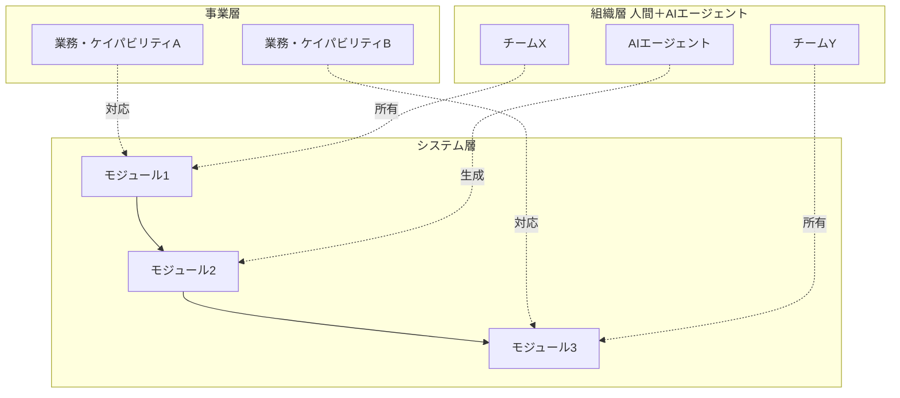
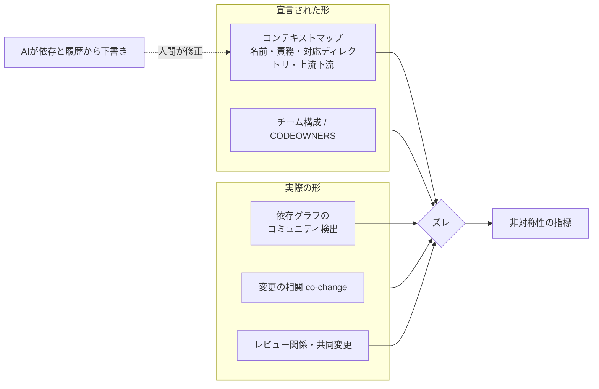
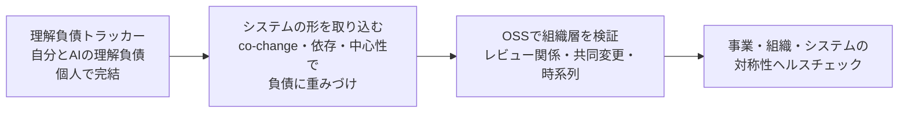

# 構想: 理解負債から始める、事業・組織・システムの対称性ヘルスチェック

2026-10-15 の壁打ちで整理した、このツールの最終的な方向性。段階1（plan.md）はこの構想の入口にあたる。

## 背景と目的

最終目標は、AI が実装を担う前提で、事業・組織・システムの形が揃っているかを健康診断すること。
理解負債はその一部で、「人間が把握すべきものと、実際に把握できているもののギャップ」として位置づける。

AI が書くほどコードと変更は速く膨らみ、意図と人の理解が追いつかなくなる。
既存の指標（カバレッジ、ベロシティなど）はこのズレを捉えられない。

位置づけは収益化ではなくポートフォリオ。「思想＋動くもの＋やってみた結果」をセットで小刻みに出す。

## 全体像: 3層と3段の見え方

事業・組織・システムの3層を、3段の解像度で見る。本丸は3段目の「層をまたぐ対応」。

| 段 | 見るもの | 指標の状態 |
| --- | --- | --- |
| 1. 末端（ノード単体） | 機能要件、性能、ステップ数、循環的複雑度、カバレッジ。理解負債もここに集約 | 既にある |
| 2. システム間（ノード同士の形） | 依存グラフ、結合、循環、中心性、変更の相関（co-change） | 未整備（モルフォロジー） |
| 3. 層をまたぐ対応 | 事業↔システム、組織↔システム、組織↔事業の写像の素直さ | 本丸。これから |

層をまたぐ指標の例: 1つの業務変更が何個のシステムに波及するか（事業↔システム）、
依存から生じる「調整が必要な人のペア」と実際にやり取りするペアの一致度（socio-technical congruence）、
チームの責任範囲がケイパビリティ単位か（組織↔事業）。

AI ありきで変わる点は2つ。AI エージェントが組織の構成員になり、「誰が書き誰が理解しているか」の写像が崩れやすくなること。
そして、その写像自体を AI が既存ドキュメントやコードから継続的に起こせること。

## 宣言された形と実際の形

ヘルスチェックの核は、人間が宣言した形と、データから検出した実際の形のズレを測ること。
コンテキストマップは正解の地図ではなく、基準線として使う。

コンテキストマップの最小構成は3つだけ:

- コンテキストの名前と、一言の責務
- 対応するディレクトリやリポジトリ
- コンテキスト同士の関係（どちらが上流か）

既存システムでは AI に下書きさせ、人間が「ここは本来この業務の一部」と直す。
その修正箇所が設計意図と実装のズレであり、レビュー行為自体が理解の確認になる。
各層のドキュメントは共通の ID やラベルで参照し合う形式にしないと、対応を数値にできない。

## 層ごとのデータソースと非対称設計

新しく書く必要があるのは、事業層の定義と層をつなぐ対応表くらい。システム層と組織層は既存の一次データでかなり代用できる。

| 層 | 一次データ | 書かないと存在しないもの | 形の精度 |
| --- | --- | --- | --- |
| システム | コード、git 履歴 | ほぼなし | 精緻（依存、循環、中心性、co-change） |
| 組織 | レビュー関係、共同変更、チャットのやり取り、CODEOWNERS | 誰が何に責任を持つかの宣言 | 最低限のエッジ |
| 事業 | 設計ドキュメント、チケット | ケイパビリティマップ、コンテキストマップ | 最低限のエッジ |

システムが最も変えにくい層なので基準線にし、他の層は対称性を測るのに必要な最低限のエッジだけ持つ。
ただし組織は図の上ほど変えやすくない（人の知識はすぐには移らない）。
出力は「ズレている。直すなら変えやすい側をこう動かすのが安い」という提案型にする（逆コンウェイの発想）。

組織側のエッジは、まずレビュー関係と共同変更の2つから。どちらも git 周りで完結し、ノードには AI エージェントも含める。
「AI が書き人間がレビューした」と「AI が書き誰も見ていない」を区別できると、組織の形と理解負債が同じグラフ上で見える。

## 時系列: 理解の持ち主の消失を検知する

人の所属は時系列で変わるが、その変化自体が一番価値のある信号。静的な一致度より、スナップショット間の差分を主役にする。

- **時間窓**: 直近90日など一定期間のエッジだけでグラフを作り、窓をずらしてスナップショットを取る
- **減衰**: 古いレビューやコミットほど重みを下げ、窓の境界での急変を避ける
- **所属履歴**: 「人→チーム」に有効期間をつけ、異動前のコミットは異動前のチームの実績として数える

検知したいのは、あるモジュールを理解していた人が異動や退職でグラフから消えたのに、その後誰もそこをレビューしていない状態。
これが理解負債の発生した瞬間。中心性が高いモジュールほど深刻度を上げる。

## アウトプットの形

見る人と頻度で3つに分ける。普段は差分が勝手に届き、気になったらマップを開く流れが理想。作るなら PR コメントか週次ダイジェストから。

| 形 | 誰が / 頻度 | 中身 |
| --- | --- | --- |
| PR へのコメント | 開発者 / 変更ごと | 「直近90日誰もレビューしていないモジュールへの依存を足している」など。理由と次の一手（推奨レビュアー）まで添える |
| 週次ダイジェスト | チームリード / 毎週 | 今週の変化を3〜5件。理解者がいなくなったモジュール、チームをまたぐ依存の増加など。全体の数値は出さない |
| マップ画面 | アーキテクト、EM / 四半期など | 依存グラフをチームごとに色分けし、ズレたエッジを赤く。宣言したコンテキストマップと重ねる。作るコストが高く「見て終わり」になりやすい |

## 個人でできる範囲とロードマップ

理解負債トラッカーを先に進め、システムの形を取り込み、OSS で組織層を試し、最終的に対称性ヘルスチェックへ広げる。
1本の物語として積み上げるほうがポートフォリオとして強い。

| 範囲 | 個人で | 備考 |
| --- | --- | --- |
| システム層のモルフォロジー | できる | 自分のリポジトリで完結 |
| 宣言と実態の突き合わせ | できる | DDD 道場などの題材と相性がいい |
| 自分と AI の理解負債 | できる | 組織が「自分と AI」の2ノードになる |
| 組織層の時系列 | OSS で代用 | 履歴を借りる。公開時は匿名化し、個人を名指ししない |

OSS は普段使う言語で、コントリビューター数十人規模、レビュー文化があり、数年分の履歴とメンテナの入れ替わりがある中規模のものを選ぶ。
形を取る最初の一歩は、言語解析なしで git 履歴だけで取れる co-change から。

## 進め方

実装はほぼ AI に任せ、人間は要所の見立てだけを押さえる。その進め方自体が「AI に任せても理解負債をためない」ことの実証になる。
具体的な役割分担と次にやることは CLAUDE.md を参照。
